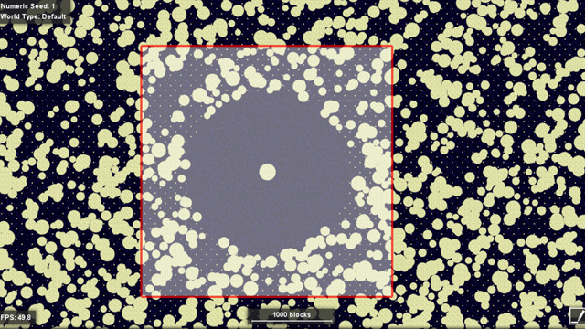

# Prune Minecraft (world_the_end)

## Description

Prunes Minecraft End dimension chunks beyond a configurable radius from the central island. Useful for resetting explored areas, managing disk space, or refreshing elytra loot locations.

Compatible with Minecraft 1.9+ through 26.x (Anvil region format).



*Thanks for coordinates and image: https://xisumavoid.com/pruneendchunks*

## Installation

```bash
git clone https://github.com/eyeskiller/minecraft-world-the-end-prune.git
cd minecraft-world-the-end-prune
chmod +x prune.sh
```

## Usage

```bash
./prune.sh -d /path/to/end/region [OPTIONS]
```

### Path to End Dimension

**Minecraft 26.1+ (new structure):**
```
/path/to/world/dimensions/minecraft/the_end/region
```

**Minecraft pre-26.1 (old structure):**
```
/path/to/world/DIM1/region
```

### Options

- `-d, --dir PATH` - Path to End dimension region directory (required)
- `-r, --radius REGIONS` - Keep region files within this radius (default: 3 = 7x7 grid = ~3,584x3,584 blocks)
- `-n, --dry-run` - Show what would be deleted without actually deleting
- `-l, --log FILE` - Log actions to specified file
- `-h, --help` - Show help message

### Examples

**Minecraft 26.1+ (new folder structure):**
```bash
./prune.sh -d /path/to/world/dimensions/minecraft/the_end/region
```

**Old Minecraft (pre-26.1):**
```bash
./prune.sh -d /path/to/world/DIM1/region
```

**Dry run** (see what would be deleted):
```bash
./prune.sh -d /path/to/world/dimensions/minecraft/the_end/region --dry-run
```

**Keep larger area** (9x9 region grid = ~4,608 blocks):
```bash
./prune.sh -d /path/to/world/dimensions/minecraft/the_end/region -r 4
```

**With logging**:
```bash
./prune.sh -d /path/to/world/dimensions/minecraft/the_end/region -l /var/log/mc-prune.log
```

## How it works

The script:
1. Scans all `.mca` region files in the specified directory
2. Extracts region coordinates from filenames (format: `r.X.Z.mca`)
3. Keeps region files within the specified radius of spawn (0,0)
4. Deletes all other region files

Each region file contains 32x32 chunks (512x512 blocks). 

Default radius of 3 keeps a 7x7 region grid:
- 7 regions × 512 blocks = 3,584 blocks per side
- Total area: ~3,584 × 3,584 blocks (about 12.8 million blocks)

This preserves the central End island and spawn area while removing distant explored chunks.

## CRON implementation

Run weekly on Sundays at 3 AM:
```cron
0 3 * * 0 /path/to/prune.sh -d /path/to/world/dimensions/minecraft/the_end/region -r 3 -l /var/log/mc-prune.log
```

**Important**: 
- Stop your server or ensure no players are in The End before pruning
- Always back up your world first
- Test with `--dry-run` before actual deletion

## Notes

- The script only affects region files in the specified directory
- Players in The End when pruning occurs may experience issues
- Deleted chunks will regenerate with fresh terrain and loot when explored again
- Based on the method described by Xisuma: https://xisumavoid.com/pruneendchunks
